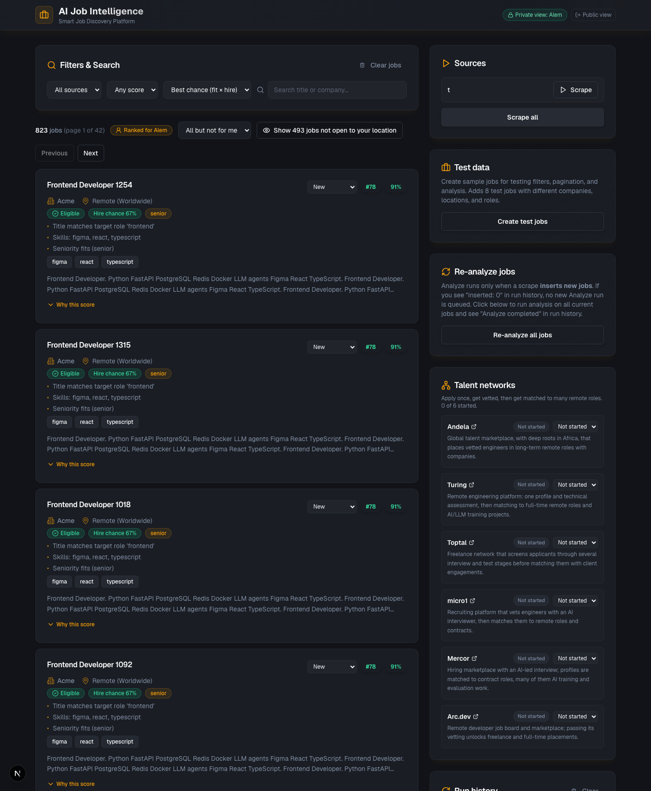
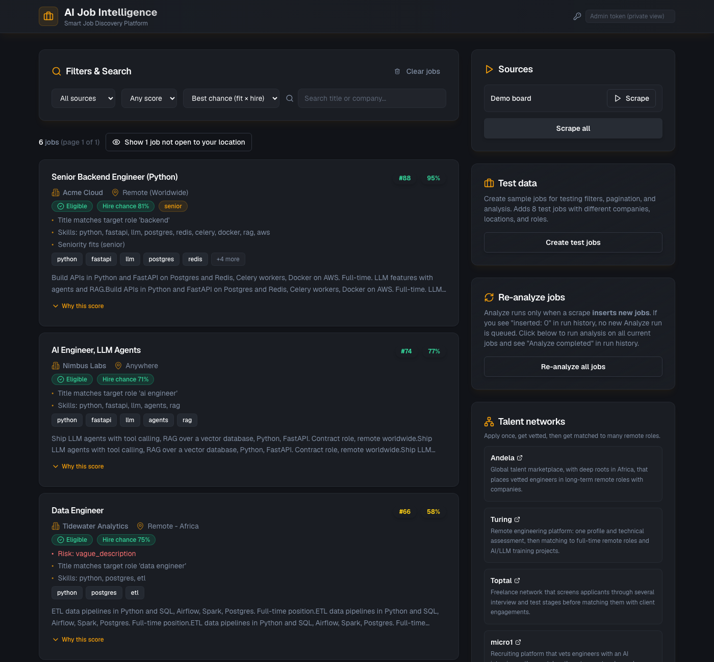
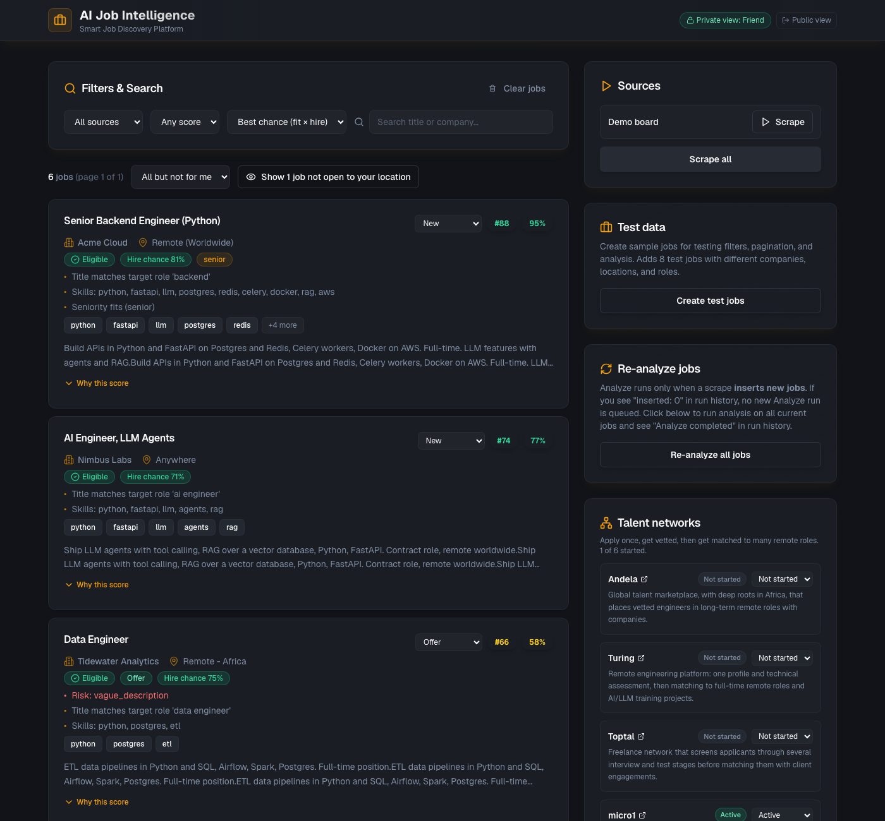

# FirstFetch — AI Job Intelligence

[](https://github.com/huss-huss/ai-job-intelligence-system/actions/workflows/ci.yml)

**Live demo:** [firstfetch-eight.vercel.app](https://firstfetch-eight.vercel.app) (read-only; refreshed daily by Vercel Cron) · API: [firstfetch-api.vercel.app/api/docs](https://firstfetch-api.vercel.app/api/docs)

FirstFetch pulls listings from public job APIs, scores each one against **your** profile with an explainable 0–100 score, and sends the strong matches to Notion.

I built it because job boards rank by recency, not fit, and most "remote" listings quietly require living in the US. FirstFetch reads the location and work-authorization rules first, so jobs you can't apply for never reach the top of the list.

```text
$ python -m worker.cli discover --sources sources.example.yaml --top 3
Rank  Fit  Hire  Elig  Title                                           Company               Source
--------------------------------------------------------------------------------------------------------------
  89   80    99  yes   Senior Data Engineer                            (company)             djinni+freehire
                       fit: Title matches target role 'data engineer' · Skills: python, llm, postgres, scraping, gcp · ...
                       hire: Open to applicants worldwide · Competition low: 0 applied, 7 views · Posted 41 h ago: early applicant · ...
  84   75    93  yes   SDET - III (RAGas Automation Testing)           (company)             freehire
                       fit: Title matches target role 'automation' · Skills: python, llm, scraping, rag, aws, gcp · ...
                       hire: Open to applicants worldwide · Competition low: 0 applied, 6 views · Posted 2 days ago · Full-time
  81   77    85  yes   Senior Backend Developer (Python)               (company)             weworkremotely+workingnomads
                       fit: Title matches target role 'backend' · Skills: python, postgres, docker, aws, gcp · ...
                       hire: Open to applicants worldwide · Timezone requirement 'CET (+/- 3 hours)' fits UTC+3 · Posted 3 h ago: ...
--------------------------------------------------------------------------------------------------------------
per source: remotive 12 (0.4 s), remoteok 89 (1.6 s), himalayas 7 (0.4 s), arbeitnow 4 (1.3 s), greenhouse 659 (6.3 s),
            lever 10 (2.4 s), freehire 137 (8.3 s), djinni 287 (3.3 s), weworkremotely 95 (4.0 s), jobicy 56 (3.0 s), workingnomads 23 (2.6 s)
1379 fetched · 1359 unique · 119 eligible · 709 not open to your location · 0 LLM calls (0 tokens)
runtime 47.1 s
```
<sub>Real output from 2026-10-19 using the rules-only extractor (no API key); company names replaced and URL lines left out here.</sub>

## How it works

```text
 sources ──► fetch ──► dedupe ──► rules extract ──► score ──► Postgres / Notion / webhook ──► LLM extract* ──► rescore
 (11 APIs +   (retry,   (per source   (skills,          (0-100 with                           (*once a day: the
  Playwright) throttle) + across      seniority,         reasons)                              day's top 30 by rules
                        boards)       salary, risks)                                           rank, within budget)
```

- **Sources** (`worker/sources/`): FreeHire, Djinni, We Work Remotely, Jobicy, Working Nomads, Remotive, RemoteOK, Arbeitnow, Himalayas, any Greenhouse or Lever careers board, plus an opt-in Playwright scraper for sites without an API (see [Sources](#sources) for each one's terms and limits). All requests go through one HTTP client with throttling, exponential backoff with jitter, `Retry-After` support, and pacing on `X-RateLimit-Remaining`/`X-RateLimit-Reset` when an API sends them.
- **Full descriptions** (`worker/sources/fulltext.py`): RemoteOK and Himalayas sometimes return only an excerpt, which under-counts skills. When a new posting from those sources has a description shorter than `FULL_DESCRIPTION_MIN_CHARS` (1500), FirstFetch fetches the posting page and uses the JSON-LD `JobPosting.description` if the page has one, or else the block holding most of the page's text, with navigation, sidebars, footers and link lists left out. Page fetches use the same throttled client, identify as `FirstFetch/…`, check `robots.txt` (cached per host, `Crawl-delay` honored) and stop trying a host after two failures in a row. The API text is kept whenever a fetch fails or the page has less text. Each scrape run has a budget, `FULL_DESCRIPTION_MAX_PAGES` (10) and `FULL_DESCRIPTION_MAX_SECONDS` (20), so the daily serverless run stays well inside its time limit. Each run's stats show `full_descriptions: {candidates, fetched, failed, skipped, ...}`. Set `FULL_DESCRIPTION_MIN_CHARS=0` to turn it off, `FULL_DESCRIPTION_SOURCES` to change which sources are fetched, or `"full_descriptions": true/false` in a source's config to override one source. Use `discover --no-full-descriptions` to skip it from the CLI.
- **Extraction** (`worker/ai.py`): keyword rules for every job. With `OPENAI_API_KEY` (or `LLM_BASE_URL` pointing at an OpenAI-compatible server such as Ollama), the day's best jobs by rules rank are also read by the model, with a strict JSON schema validated by Pydantic, inside a hard monthly budget. Any failure falls back to rules, with a warning, instead of failing the run. See [AI features and budget](#ai-features-and-budget).
- **Scoring** (`worker/matching.py`): deterministic, so it's testable and auditable. The LLM supplies facts; it doesn't decide the score.

  | Component | Points | Notes |
  |---|---|---|
  | Role | 25 | target title in the job title (5 if only in the description) |
  | Skills | 35 | weighted coverage of your top skills; halved for off-target titles |
  | Location | 15 | "USA only", work-authorization clauses, and on-site roles make a job **ineligible** (score capped at 20) |
  | Seniority | 10 | |
  | Salary | 10 | top of the range, normalized to annual USD, against `min_salary_usd` (5 when unknown) |
  | Recency | 5 | days since the posting went live, or since its last update when the source reports one (see below) |
  | Risk flags | −10 each | commission-only, unpaid, upfront fees, vague postings |

- **Hire probability** (`worker/hire.py`): a second, separate 0–100 score for *can I realistically get this job?*, with its own reasons. See [Hire probability and rank](#hire-probability-and-rank). Jobs are ranked by `rank`, the geometric mean of fit and hire probability.

- **Cross-source dedupe** (`worker/pipeline.py`): the same job seen on several boards becomes one posting. Two postings are linked when their URLs match after dropping `www.`, trailing slashes and tracking parameters (`utm_*`, `ref`, …), which catches FreeHire's copies of Djinni and We Work Remotely jobs, or when normalized title + company match across different sources, including We Work Remotely's `Company: Title` style that other boards copy into the title. One board listing the same title twice is kept as two openings. The richest record wins (most structured facts, then longest description), its gaps are filled from the others, the longest description is kept, the link-back board's URL stays the job URL, a board that posted the job directly beats an aggregator on location, and every board's URL is kept in `source_urls` (stored in `jobs_raw.meta`).

- **Recency dates**: `posted_at` is always when the posting first went live. Greenhouse also returns `updated_at`, which keeps moving while a role stays open, so a requisition first published months ago isn't scored as stale: recency uses the newer of the two, and the reason says which (`Updated 3 days ago, first posted 251 days ago` vs `Posted 60 days ago`). An update less than a day after publishing counts as the original post. `updated_at` is kept in `jobs_raw.meta` (no column) and refreshed on every scrape, so `POST /api/analyze` rescores stored rows. Lever's public API only has `createdAt`, so Lever recency is the creation date; the other boards report a single publication date.

- **Salary normalization** (`worker/salary.py`): hourly × 2080 (40 h × 52 weeks), daily × 260, weekly × 52, monthly × 12; no period means annual and no currency means USD. Other currencies convert with a dated static table (USD per unit), which `FX_RATES_JSON='{"EUR": 1.1}'` overrides or extends. A currency or period the table doesn't know is scored as unknown, never guessed. Period and currency are read from the source's fields or from text such as `$40/hr`, `€5,000 per month`, `£70k`, `USD 120,000 - 150,000`. The reason shows both figures, e.g. `Salary up to €60,000/yr ≈ $70,200`. Stored `salary_min`/`salary_max` stay in the source's own unit.

- **Dashboard** (`frontend/`): jobs are sorted by rank by default (a selector switches to best fit or newest). Each job card shows the rank, the fit score, the top reasons, an eligibility badge (Eligible / Not open to your location / Eligibility unknown) and a hire-chance badge. "Why this score" expands the per-component points as bars, the risk penalty, the ineligible cap and the matched skills, all read from the stored `extracted_json.match`, then the hire-probability gates, weighted factors and reasons from `extracted_json.hire`. Jobs not open to your location are hidden by default; the "Show N jobs not open to your location" toggle brings them back.

- **Notion** (`worker/notion.py`): upserts keyed by job URL, so re-runs update scores without duplicating pages. The `Status` you set in Notion is never overwritten.

- **Telegram and tracker** (`backend/app/telegram/`, `backend/app/tracker.py`): a daily digest of the best new matches with Applied / Save / Not for me buttons, an owner-only bot, and a per-job application tracker whose 👎/⭐/✅ history nudges similar jobs down or up. See [Telegram alerts](#telegram-alerts).

**Stack:** Python 3.12, FastAPI, SQLAlchemy + Alembic, PostgreSQL (pgvector), Redis + RQ, httpx, Pydantic, Next.js dashboard, Docker Compose, GitHub Actions.

## Sources

| Source (`type`) | Endpoint | Filters FirstFetch sends | Terms and limits |
|---|---|---|---|
| FreeHire (`freehire`) | `GET https://freehire.me/api/v1/agent/jobs/search` ([OpenAPI](https://freehire.me/openapi.yaml)) | any search param: `q` (with `title:` and `OR`), `work_mode`, `regions`, `employment_type`, `is_tech`, `posted_within_days`, `sort`, `limit`/`offset`; several `queries` per source, list values sent as repeated params | No key. 300 req/min for agent search, 600/min for other reads; `X-RateLimit-*` on every response and `429` + `Retry-After`. Asks for a User-Agent naming the project. Unknown params are dropped and listed in `meta.ignored_params`: FirstFetch fails the source (`strict: false` logs instead). Optional `company_remote_regions` reads `/companies?remote_regions=` to learn which companies hire remotely in Africa. Each request retries twice with waits capped at 10 s (FreeHire sometimes answers 522 with a long `Retry-After`), and `max_seconds` (45) bounds the whole source. |
| Djinni (`djinni`) | `https://djinni.co/jobs/rss/` | `primary_keyword`, `exp_level`, `english_level`, `employment` | Public RSS, up to 100 items per query. Other params (`region`, `keywords`, `page`) are silently ignored by the feed, so FirstFetch refuses them. |
| We Work Remotely (`weworkremotely`) | `https://weworkremotely.com/categories/remote-<category>-jobs.rss` | one feed per `categories` entry (`back-end-programming`, `full-stack-programming`, `devops-sysadmin`, `programming`, …) | Terms ask for a link back: the weworkremotely.com URL stays the job URL. `<country>`, when present, is the real restriction (`<region>` says "Anywhere in the World" even then). |
| Jobicy (`jobicy`) | `https://jobicy.com/api/v2/remote-jobs` ([docs](https://github.com/Jobicy/remote-jobs-api)) | `count`, `geo` (`anywhere`, `emea`, …), `industry`, `tag` | Automated sync passes at most once per hour (the daily cron is well inside that); credit Jobicy and send applicants to the listing URL. `appliedFilters` is checked: a filter that wasn't applied fails the source. Last 7 days only. |
| Working Nomads (`workingnomads`) | `https://www.workingnomads.com/api/exposed_jobs/` | none server-side; `categories` and `keywords` filter locally | Latest ~40 listings, no parameters. |
| Remotive, RemoteOK, Arbeitnow, Himalayas, Greenhouse, Lever | see `worker/sources/adapters.py` | | see [Limitations](#limitations-and-next-steps) |

Every source accepts `max_age_days` (drop older postings) and `max_results`. `sources.example.yaml` has queries tuned for a remote backend/AI engineer in Ethiopia.

## Hire probability and rank

The fit score says whether a job is right for you. Hire probability (`worker/hire.py`) says whether applying is likely to pay off. Each factor is 0–1 and gets a reason:

```text
hire_probability = 100 × eligibility × timezone × language × risk × (Σ weight × factor / 100)
rank             = round(100 × √(fit/100 × hire_probability/100))
```

Gates multiply because any one of them can make an application pointless; the weighted factors average because they trade off.

| Factor | Kind | Value |
|---|---|---|
| Eligibility certainty | gate | 1.0 explicitly worldwide / anywhere / global / Africa / your country (location text, or FreeHire `regions`/`countries`); 0.9 when the LLM read an explicit "worldwide" or your region in the posting ("AI read: …"); 0.9 EMEA; 0.75 MENA (Ethiopia isn't always counted in it); 0.85 posting silent but FreeHire lists the company as hiring remotely in Africa; 0.9 another of your `eligible_terms`; 0.5 bare "Remote"; 0.02 not open to your location (same verdict as the fit score) |
| Timezone | gate | stated requirements in the location, timezone note or description ("US time zones only", "CET ±2h", "UTC-3 to UTC+3", "overlap with EST", which adds 4 h of slack) against `timezone`: 1.0 inside the window, 0.75 within 2 h, 0.45 within 4 h, 0.25 within 6 h, else 0.1; 1.0 when nothing is stated |
| Risk | gate | the lowest of the posting's risk flags (rules or LLM): not a real job or asks you to pay 0.1, unpaid 0.3, commission only 0.5; else 1.0 (a vague description only costs fit points) |
| Language | gate | 0.1 if another language is required ("fluent German", "French is a must", "Japanese-speaking"; "… is a plus" doesn't count) and it isn't in `languages`; 0.35 if the posting itself isn't in English (source field, or script/stopword detection); else 1.0 |
| Competition | weight 30 | pressure = applicants + views/20; factor = 1 / (1 + 4 × pressure / `max_competition`), floor 0.1. With the default 50: 0 → 1.0, 12.5 → 0.5, 25 → 0.33, 50 → 0.2. Unknown (most boards) 0.5 |
| Freshness | weight 30 | 1.0 for the first 48 h, then halves every 5 days (7 days ≈ 0.5, 12 days ≈ 0.25), floor 0.05; unknown date 0.4. FreeHire postings whose date the source keeps restating (`fake_freshness`) are dated from when FreeHire first saw them |
| Seniority | weight 20 | 1.0 when the stated (source) or title level is in your `seniority`, 0.55 one level off, 0.25 two, 0.1 further; 0.7 unknown. Halved (or quartered) when the posting asks for more years than `years_experience`, if you set it |
| Employment type | weight 20 | your `employment_types` weight (default full-time 1.0, contract 0.6); types you don't list 0.1; unknown 0.8. Read from the source, else the title, else a clear phrase like "this is a contract role" |

Profile settings (all optional, defaults suit a remote job search from Ethiopia):

```yaml
employment_types: {full_time: 1.0, contract: 0.6}
timezone: UTC+3
max_competition: 50
languages: [english, amharic]
location: {country: Ethiopia, country_code: et}
# years_experience: 5
```

The worker stores `extracted_json.hire` (`score`, `factors`, `reasons`), `extracted_json.hire_probability` and `extracted_json.rank` (both 0–100) next to `match`; `score` stays the 0–1 fit score. `GET /api/jobs?sort=rank` orders by rank, then fit. The dashboard's `ScoreDetails` mirrors the weights above.

## AI features and budget

Two optional features use an OpenAI model, both through one budgeted caller (`worker/llm.py`, `worker/budget.py`):

1. **Extraction** of job facts for the day's best jobs: who may apply (`location_restriction`, `worldwide`), seniority,
   employment type, timezone requirement, minimum years, risk flags. They feed the fit score and
   [hire probability](#hire-probability-and-rank). When the model's reading changes eligibility, the job says so:
   *AI read: applicants must be in the United States* or *AI read: open to applicants worldwide*. The model can settle
   an unknown ("Remote") either way and catch a restriction the rules missed, but never re-opens a job the rules found
   restricted.
2. **Cover letters** in Telegram: the **✍️ Cover letter** button under every digest and `/top` card, or
   `/cover <job id>`. The letter is written from your resume (`/cv`: paste the text, or upload a .txt, .md or .pdf;
   the owner can also run `python -m worker.cli set-resume resume.pdf`), the job's title, company and description, and
   your profile. The prompt asks for at most 220 words tied to the job's stated requirements, a professional tone
   without clichés, plain text you can paste, and above all honesty: nothing that isn't in the resume, and nothing
   claimed that the resume doesn't show (`worker/cover_letter.py`, `HONESTY_RULES`). The letter is sent to you and not
   stored; only the usage row (tokens and cost) is. (`/resume` already resumes the digest, so the resume command is
   `/cv`.)

**Models and prices** (`MODEL_PRICES` in `worker/llm.py`, from the
[OpenAI pricing page](https://developers.openai.com/api/docs/pricing) on 2026-10-19):

| Model | Input / 1M tokens | Output / 1M tokens | Used for |
|---|---|---|---|
| `gpt-6-luna` | $0.10 | $0.50 | both features (default) |
| `gpt-4.1-mini` | $0.40 | $1.60 | fallback, only if `gpt-6-luna` isn't available on the key (404/403) |

Reasoning tokens are billed as output and count against the output cap. Cached-input discounts are ignored, so
recorded costs are an upper bound. `LLM_PRICES_JSON='{"model": [0.1, 0.5]}'` adds or corrects a price; a model with no
known price is refused rather than guessed (a non-OpenAI `LLM_BASE_URL`, e.g. Ollama, counts as free).

**Model parameters.** Each model gets only what it accepts (`MODEL_CAPS`): `gpt-6-luna` gets no `temperature`,
`max_completion_tokens` and `reasoning_effort: "low"` (`LLM_REASONING_EFFORT` overrides it); `gpt-4.1-mini` gets
`temperature` and `max_completion_tokens`; unknown models (local servers) get the classic `max_tokens`. If the API
still answers 400 "unsupported parameter", the call is retried once without it (or with the other token parameter),
and the process remembers that for the model. The installed SDK (`openai==1.55.3`) has no Responses API and no
`reasoning_effort` keyword, so calls use chat completions with a `json_schema` `response_format`, and
`reasoning_effort` is sent in `extra_body`. SDK retries are off: every retry would be another billable request.

**The budget guard** is local and hard, independent of the limit on the OpenAI account. Before every call it estimates
the worst case (input estimated at 3 characters per token, which over-counts, plus the whole output cap) and, in one
locked transaction (a Postgres advisory lock), refuses if

- month-to-date cost (UTC calendar month) + the estimate would exceed `LLM_MONTHLY_BUDGET_USD`, or
- today's extractions (all users) reached `LLM_MAX_EXTRACTIONS_PER_DAY`, or
- your cover letters today reached `LLM_MAX_COVER_LETTERS_PER_DAY`,

and otherwise reserves the estimate in `llm_usage`. After the call the reservation is replaced by the usage the API
reports (input, output and reasoning tokens). A rejected request (4xx, not billed) is deleted; a timeout keeps the
estimate, since OpenAI may have billed it. A refused cover letter gets a friendly reply ("You've reached today's
limit of 5 cover letters…", or "This month's AI budget is used up…"); a refused or failed extraction keeps the rules
facts, logs a warning and is counted under `llm_fallbacks` in the run stats.

**Which jobs get extraction.** Every job is scored by rules first. Once a day, after all sources are scraped (the
same cron request), `run_llm_enrich_task` takes the jobs of the last 36 hours that only have rules facts and sends N of
them, where N is what's left of today's extraction cap. The N are shared fairly by the active users (a valid profile,
digest not paused): each user's open jobs are ranked by *their own* rules rank (`user_job_scores`, filled in first for
anyone missing rows), and the users take turns (`fair_select` in `worker/pipeline.py`), each adding their best job not
picked yet. With two users each list contributes N/2; a job at the top of both lists is extracted once and the next
turn moves on, and the user who goes first rotates daily so neither always gets the odd extra. Jobs with a zero fit for
that user (excluded titles) aren't on their list. With no active user it's the public top N, as before. The number of
calls is the same N whatever the number of users, and every call still goes through the same daily cap and monthly
guard, so cost doesn't grow with users. Four calls run at once (`LLM_CONCURRENCY`), none starts after
`LLM_ENRICH_MAX_SECONDS` (75), and since the facts belong to the job, each enriched job is rescored for the public
profile and every user, whoever's list picked it. A job whose call failed or returned invalid output isn't tried
again. The run is a `llm_enrich` row in run history with tokens, cost, fallbacks, month-to-date spend and
`selected_by_user` / `enriched_by_user` (extractions per user id; only the owner sees that split in `GET /api/runs`)
plus `shared_skipped` (turns that skipped a job another list had already picked).
`python -m worker.cli llm-enrich` runs the same step by hand; `discover` from the CLI does the same top-N selection,
with its ledger in the database when `DATABASE_URL` is set and otherwise in `LLM_USAGE_FILE`.

**`/stats`** ends with the AI lines. The owner sees the month's spend against the budget, split by feature, and
today's extraction and cover-letter counts for everyone; a member sees only their own cover letters today.

| Variable | Default | |
|---|---|---|
| `OPENAI_API_KEY` | | without it (and without `LLM_BASE_URL`) every AI feature is off and nothing is called |
| `OPENAI_MODEL` | `gpt-6-luna` | |
| `LLM_FALLBACK_MODEL` | `gpt-4.1-mini` | used only when `OPENAI_MODEL` isn't available on the key; empty turns it off |
| `LLM_MONTHLY_BUDGET_USD` | `0.80` | hard local cap per UTC month, under the $1 limit set on the OpenAI account |
| `LLM_MAX_EXTRACTIONS_PER_DAY` | `30` | all users together; also the N in "top N jobs a day", shared by the active users |
| `LLM_MAX_COVER_LETTERS_PER_DAY` | `5` | per user |
| `LLM_REASONING_EFFORT` | | override the model's default (`low` for `gpt-6-luna`), e.g. `minimal` |
| `LLM_PRICES_JSON` | | extra or corrected prices |
| `LLM_TIMEOUT_SECONDS`, `LLM_CONCURRENCY`, `LLM_ENRICH_MAX_SECONDS` | `30`, `4`, `75` | |
| `LLM_BASE_URL` | | an OpenAI-compatible server instead of OpenAI (not billed) |
| `LLM_USAGE_FILE` | `.firstfetch/llm_usage.json` | ledger for CLI `discover` without a database |

**Monthly cost estimate** with `gpt-6-luna` (prices above):

| | Input tokens | Output tokens (incl. reasoning) | Per call | Per month |
|---|---|---|---|---|
| extraction, typical | ~2,000 (system prompt ~190, schema ~630, posting up to 6,000 characters) | ~400 | 2,000 × $0.10/1M + 400 × $0.50/1M = **$0.0004** | 30 × 31 = 930 calls → **$0.37** |
| extraction, reserved worst case | ≤ 3,152 (over-estimate) | 1,000 (the cap) | $0.000315 + $0.0005 = $0.00082 | 930 → $0.76 |
| cover letter, typical | ~3,300 (resume up to 8,000 characters, job up to 5,000) | ~500 | $0.00033 + $0.00025 = **$0.0006** | 2 a day → 62 → **$0.04** |
| cover letter, reserved worst case | ≤ 4,890 | 1,400 (the cap) | $0.00049 + $0.0007 = $0.0012 | 5 a day per user → 155 → $0.18 |

A typical month is about **$0.41**. The worst cases can't all happen: the guard stops every call once the month
reaches $0.80, which leaves $0.20 of headroom under the account's $1 limit. With `gpt-4.1-mini` as the fallback the
same month costs about 3.6 times as much, so the budget, not the caps, would end AI use for the month early; that's
the intended behaviour.

**Checking quality** (once, before relying on it): `llm-eval` picks 20 recent stored jobs, a mix of eligible / not
open to you / unknown, extracts each with rules and with the model, and prints where they disagree (eligibility,
seniority, employment type, risk flags) with the total tokens and cost. Its usage counts toward the monthly budget,
not the daily extraction cap.

```bash
DATABASE_URL=<unpooled url> python -m worker.cli llm-eval --jobs 20 --dry-run   # estimate only, nothing is sent
read -rs OPENAI_API_KEY && export OPENAI_API_KEY
DATABASE_URL=<unpooled url> OPENAI_MODEL=gpt-6-luna python -m worker.cli llm-eval --jobs 20 --run
```

The dry run prints a typical and a worst-case cost. For 20 full-length (6,000-character) postings that's about
$0.010 and $0.016; both use the over-counted input estimate, so the real bill is lower (about $0.008 at full length,
less for shorter postings). `--run` refuses if the worst case would go over what's left of the month's budget.

## Quick start (no database)

```bash
python3 -m venv .venv && source .venv/bin/activate
pip install -r backend/requirements.txt -r worker/requirements.txt
cp profile.example.yaml profile.yaml        # edit titles, skills, location, salary floor
python -m worker.cli discover --top 15
python -m worker.cli discover --sources sources.example.yaml --json results.json
```

### Notion

1. Create an internal integration at https://www.notion.so/my-integrations and share a database with it.
2. Set `NOTION_TOKEN` and `NOTION_DATABASE_ID` in `.env`.
3. `python -m worker.cli notion-setup` adds the properties FirstFetch writes.
4. `python -m worker.cli discover --notion` syncs eligible jobs at or above `notify_threshold`.

### Telegram alerts

A Telegram bot sends you the day's best new matches and lets you track them from the chat. It talks
to the Bot API directly over httpx (`backend/app/telegram/`) and only answers your own chat and the people
you invite (see [Multi-user](#multi-user)).

**Daily digest.** At the end of the daily cron run (`GET /api/cron/discover`, so no extra cron is
needed) FirstFetch sends every user who hasn't paused it their own digest: up to `TELEGRAM_DIGEST_SIZE` (5) jobs that were stored in the last
`TELEGRAM_DIGEST_MAX_AGE_DAYS` (7) days, are eligible or of unknown eligibility for *their* profile, they haven't acted
on yet, were never sent to them before, and score at least `TELEGRAM_DIGEST_MIN_SCORE` (60, after their
feedback adjustment below) on their own score: `rank` (fit × hire probability) when present, else fit. Each job is
one message: title, company, location, score (and hire probability when present), the top two reasons and
an apply link, with buttons **✅ Applied · ⭐ Save · 👎 Not for me · 🔗 Open** (and **✍️ Cover letter** when AI is on). Tapping a button updates the
tracker and redraws the message with the new status (↩️ Undo resets it). A job is marked as sent only after
Telegram accepted it, so nothing is sent twice and a failed send is retried the next day. With nothing new
the bot sends one line, "No new strong matches today"; set `TELEGRAM_DIGEST_SEND_EMPTY=false` to skip it.
Telegram errors never fail the cron run: they're logged and recorded in a `telegram` row in run history.
In Redis mode, jobs analyzed after the cron request finishes go out in the next day's digest.

**Commands** (each user works on their own profile, tracker and digest):

| Command | What it does |
|---|---|
| `/top` | your best 5 open matches you haven't acted on (last 30 days) |
| `/today` | jobs stored since yesterday, with your scores |
| `/applied` | your tracked jobs with status and notes |
| `/stats` | pipeline counts, your eligibility split, tracker and AI usage (spend vs budget for the owner) |
| `/status <job id> <status>` | e.g. `/status 42 interviewing` |
| `/pause`, `/resume` | your daily digest |
| `/profile` | your profile: titles, skills, seniority, country, salary, employment types |
| `/skills add\|remove <skill> [weight]` | weight 1 (nice to have) to 3 (core), default 2 |
| `/titles add\|remove <title>` | target job titles, e.g. `/titles add platform engineer` |
| `/salary <min USD/yr>` | `30000`, `30k` or `none` |
| `/country <name> [ISO code]` | e.g. `/country Kenya ke`; updates the locations you count as eligible |
| `/seniority <levels>` | any of intern, junior, mid, senior, lead, e.g. `mid,senior` |
| `/employment <types>` | full_time, part_time, contract, internship, optional weights: `full_time,contract:0.6` |
| `/dashboard` | a private dashboard link with your statuses (shown once; `/dashboard revoke` turns it off) |
| `/cover <job id>` | a cover letter for that job from your resume (also the ✍️ button under each job; needs `OPENAI_API_KEY`) |
| `/cv [text]` | your resume for cover letters: paste it after `/cv`, or upload a .txt, .md or .pdf file; `/cv delete` removes it |
| `/help` | the list above |
| `/invite` | owner only: a single-use invite link, valid 48 h |
| `/users` | owner only: who has access |
| `/remove <user id>` | owner only: remove a member and delete their data |

Profile edits are validated by the same `CandidateProfile` model the worker uses, and rescore your jobs
from the last 30 days right away, so `/top` reflects the change.

The client keeps under Telegram's limits: requests are spaced to stay under 30 messages a second, a 429 is
retried after the `retry_after` Telegram asks for (up to 30 s, three times), messages are HTML with every
field escaped, and lists longer than 4096 characters are split between whole lines.

**Setup** (about five minutes):

1. In Telegram, open [@BotFather](https://t.me/BotFather), send `/newbot`, pick a name and a username
   ending in `bot`. BotFather replies with the bot token.
2. Make a webhook secret: `python3 -c "import secrets; print(secrets.token_urlsafe(32))"`.
3. Add the token and the secret to the API project, in the Terminal app, from the repo root (each command
   prompts for the value, so it never lands in your shell history):
   ```bash
   vercel env add TELEGRAM_BOT_TOKEN production
   vercel env add TELEGRAM_WEBHOOK_SECRET production
   vercel deploy --prod
   ```
4. Point the bot at the API. Run this locally with the same two values (`read -s` keeps them out of the
   history too):
   ```bash
   read -rs TELEGRAM_BOT_TOKEN && export TELEGRAM_BOT_TOKEN
   read -rs TELEGRAM_WEBHOOK_SECRET && export TELEGRAM_WEBHOOK_SECRET
   python -m worker.cli telegram-setup --url https://<your-api-project>.vercel.app
   ```
   It calls `setWebhook` with the secret and `drop_pending_updates`, and registers the command menu.
5. Send `/start` to your bot. It replies with your chat id, and that's all it does until the id is set.
6. Add the chat id and redeploy:
   ```bash
   vercel env add TELEGRAM_CHAT_ID production
   vercel deploy --prod
   ```
7. Check it: `TELEGRAM_CHAT_ID=<id> python -m worker.cli telegram-test` sends a test message, and
   `DATABASE_URL=... python -m worker.cli telegram-digest --dry-run` prints what the digest would send now.

The webhook (`POST /api/telegram/webhook`) only accepts requests carrying the secret in Telegram's
`X-Telegram-Bot-Api-Secret-Token` header (compared in constant time). That header is also the only way
past the `ADMIN_TOKEN` write lock, and only for this one path. Updates from any chat that isn't a user are
ignored without a reply, except an invite code (see [Multi-user](#multi-user)).

| Variable | Default | |
|---|---|---|
| `TELEGRAM_BOT_TOKEN` | | from BotFather; without it the bot and the digest are off |
| `TELEGRAM_WEBHOOK_SECRET` | | 1-256 characters of `A-Z a-z 0-9 _ -` |
| `TELEGRAM_CHAT_ID` | | your chat id, from `/start` |
| `TELEGRAM_DIGEST_SIZE` | 5 | jobs per digest |
| `TELEGRAM_DIGEST_MIN_SCORE` | 60 | 0-100, after feedback |
| `TELEGRAM_DIGEST_MAX_AGE_DAYS` | 7 | only jobs stored within this many days |
| `TELEGRAM_DIGEST_SEND_EMPTY` | true | send "no new strong matches" |
| `TELEGRAM_TIMEZONE` | Africa/Addis_Ababa | times shown in messages |
| `TELEGRAM_DASHBOARD_URL` | | the dashboard's URL, for the personal links `/dashboard` sends |
| `TELEGRAM_DIGEST_MAX_SECONDS` | 90 | stop sending digests (to the remaining users) after this long |

Members can override the digest size and minimum score per user (`users.digest_size`,
`users.digest_min_score`); without an override they use the values above.

### Multi-user

FirstFetch is invite-only. The owner is whoever `TELEGRAM_CHAT_ID` and `ADMIN_TOKEN` belong to; they can
invite a few friends, each of whom gets their own profile, scores, tracker, feedback, talent-network
progress and daily digest. Nobody else can use the bot.

**Inviting someone**

1. The owner sends `/invite` to the bot. It replies with a link, `https://t.me/<bot>?start=<code>`, and the
   same code as `/start <code>`. The code is 32 random URL-safe characters (192 bits), works once and
   expires after 48 hours. Only its SHA-256 is stored; the bot shows it this one time.
2. The friend opens the link (or sends `/start <code>`) in a private chat with the bot. They become a
   member, their profile starts as a copy of the owner's, and the owner gets a "… joined" message.
3. The friend makes the profile theirs with `/profile`, `/skills`, `/titles`, `/salary`, `/country`,
   `/seniority` and `/employment`. The next digest uses it.

A wrong code gets "invalid, used or expired". Five wrong codes from one chat within 15 minutes lock that
chat out for an hour (silently: no more replies), and 50 wrong codes across all chats within an hour pause
redemption for everyone for an hour. With 192-bit codes guessing is hopeless anyway; the throttle keeps it
cheap. The throttle table stores a hash of the chat id, not the id. At most 20 members.

**Privacy model**

| Data | Who can read it |
|---|---|
| jobs, descriptions, the public score (`jobs_analysis`, from the deployment profile) | everyone (portfolio demo) |
| your statuses, notes, feedback, talent-network progress, your scores, profile | you, in the bot and with your dashboard link |
| your resume (`/cv`) | you, in the bot (only sent to the model for your own cover letters; no API route returns it) |
| the owner's | the owner (bot, `ADMIN_TOKEN`, or their own dashboard link) |
| who the users are (`/users`) | the owner |

- `GET /api/applications` and `GET /api/me` answer 401 without a token; `GET /api/talent-networks` returns the
  platform list without anyone's progress; `GET /api/jobs?status=` needs a token (the filter would reveal what
  someone applied to), and job payloads never carry tracker fields; telegram runs in `GET /api/runs` show the
  public only totals, and LLM enrichment runs show the per-user extraction counts only to the owner. A token
  scores `GET /api/jobs` for its own user and nobody else (`tests/test_user_scores_api.py`). Tests seed every kind of private data for two users and call every GET route
  (`tests/test_privacy.py`); a new GET route fails that test until it's reviewed.
- Tokens: `X-Admin-Token: <ADMIN_TOKEN>` is the owner. `X-User-Token` is a personal dashboard token from
  `/dashboard`: 32 random bytes, stored as SHA-256, shown once, replaced by the next `/dashboard`, revoked by
  `/dashboard revoke`. It reads and writes only that user's tracker and talent networks; every other write
  still needs the admin token. All comparisons are constant-time. With no `ADMIN_TOKEN` configured, private
  data isn't readable over HTTP at all.
- The dashboard link is `https://<dashboard>/#token=…`. The token is in the URL fragment, which browsers
  never send to a server; the dashboard moves it to localStorage and strips it from the address bar. Without
  a token the dashboard is the public view: no status selects, badges or filters, and the talent-network
  list without progress. "Public view" in the header forgets the token on that browser.
- Owner-only commands (`/invite`, `/users`, `/remove`) check the role on every call; to a member they are
  "Unknown command".
- Logs never contain chat ids, names, invite codes or tokens (errors are logged by type only).

**Data stored per user:** Telegram chat id, the first name Telegram sends (for `/users`), role, profile,
digest settings and pause flag, join and last-seen times, the hash of their dashboard token, the resume they
sent with `/cv` (cover letters themselves are never stored); their
statuses, notes and notification times (`applications`), talent-network statuses, and their score for each
job (`user_job_scores`: fit, hire probability, rank, eligibility, reasons).

**Removal:** `/remove <id>` (owner only) deletes the member and everything above: profile, resume, tracker,
notes, feedback, talent-network statuses, scores and dashboard token. Invites they used stay as used, and their
AI usage rows (date, model, token counts and cost, nothing they wrote) stay so the month's spend stays correct,
both without a link to them. Their chat is a stranger again and is ignored. The owner can't be
removed. Rolling back migration 004 also drops every member's data and keeps the owner's.

**Scoring per user.** Fetching and extracting facts (and LLM calls, when configured) happens once per job.
Scoring those facts against a profile is rules only, about 1 ms per job, so the analysis run scores each new
job for every user right after the public score and stores it in `user_job_scores`, with one delete and a
multi-row insert per batch, so a second user adds no per-job database round trips. A profile edit rescores
that user's last 30 days; jobs without a row for someone (stored before they joined) are scored the first
time their digest or `/top` needs them. The owner's profile is the deployment's (`PROFILE_YAML` /
`PROFILE_PATH` / `profile.example.yaml`) until they edit it in the bot. The dashboard's private view and the
choice of which jobs get LLM extraction use each user's own scores too (see below and
[AI features and budget](#ai-features-and-budget)).

**Your scores on the dashboard.** With a token, `GET /api/jobs` (and `/api/jobs/{id}`) returns the viewer's
own score in the same response shape, so the dashboard needs no second request: `analysis.score` (0–1),
`analysis.skills` and `extracted_json.match`, `.hire`, `.hire_probability` and `.rank` come from that user's
`user_job_scores` row, and `extracted_json.score_scope` is `"user"`. `sort=rank` / `sort=score`, `min_score` and
`eligible` use the same values. A job the viewer has no row for (stored before they joined and older than the
30-day catch-up) keeps the public score, marked `score_scope: "public"`, and sorts after their scored jobs.
Without a token nothing changes: the public score and no `score_scope`. The private view says
"Ranked for <name>" above the list. The join is a `LEFT JOIN user_job_scores ON (user_id, job_id)`, the table's
primary key, so the request is still three SQL statements (count, page, analyses).



Measured on a local Postgres 17 with 1316 synthetic jobs (~4 KB descriptions, rules extractor):

| Step | 1 user | 2 users |
|---|---|---|
| analysis of all 1316 jobs | 3.0 s, 2648 SQL statements | 4.1 s, 2646 SQL statements |
| rescore one user after a profile edit (1316 jobs) | | 1.2 s, 8 SQL statements |
| catch-up for a new member (1316 jobs) | | 1.2 s, 9 SQL statements |
| catch-up when nothing is missing | | 2 ms, 1 query |
| digests (fake Bot API) | | 0.05 s, 12 API calls |

The daily cron analyzes only new jobs, so a second user adds well under a second of scoring plus their
digest's 2-6 Telegram messages to a run that took 39 s in production.

The per-user dashboard and the fair LLM selection, measured the same way (1316 jobs, a second user with a
different profile, fake chat-completions API with no latency, so the numbers are FirstFetch's own overhead):

| Step | before (owner's rank only) | now, 2 users |
|---|---|---|
| choosing the 30 jobs for extraction | 12 ms, 1 query | 16-18 ms, 5 queries (each user's catch-up check, open jobs, both users' ranks) |
| the whole `llm_enrich` run (30 calls) | 0.17 s, 219 SQL statements | 0.17-0.19 s, 224 SQL statements |
| LLM calls and cost | 30, $0.0060 | 30 (15 from each list), $0.0060 |
| `GET /api/jobs?sort=rank&eligible=true,unknown` (median of 20) | 9.7-10 ms public | 11-12 ms with a token (includes the token lookup) |

The page query with a token runs in about 1 ms on Postgres (`EXPLAIN ANALYZE`; at this size the planner hashes
the 1316 score rows, and `tests/test_user_scores_api.py` checks it can use the primary key instead). The cron run
gains a few milliseconds; the calls themselves are the same 30.


### Application tracker

Every job can have a status per user: `new`, `saved`, `applied`, `interviewing`, `offer`, `rejected` or
`not_interested`, plus notes and timestamps (status changed, first applied, sent to Telegram). It's stored in
the `applications` table (one row per user and job, migrations `003_tracker` and `004_multi_user`), separate
from the scraped data, so re-scraping or re-analyzing never touches it. Set it from the Telegram buttons, `/status`, the select on each dashboard
card, or the API (`GET /api/applications?status=saved,applied`, `PATCH /api/applications/{job_id}` with
`{"status": "applied", "notes": "..."}`). The dashboard hides jobs marked "not for me" by default; the
status filter brings them back. All of it is private: the API needs the admin token or your personal
dashboard token, and the public dashboard shows no statuses (see [Multi-user](#multi-user)).

**Feedback learning** (`backend/app/tracker.py`) is a small, fixed rule, not a model. When ranking the
digest and `/top`, each job is compared with the jobs you reacted to (yours only; another user's 👎 never
moves your ranking). Two jobs are *similar* when they
share at least 2 keywords and their keyword sets overlap by at least half (Jaccard ≥ 0.5); keywords are the
matched skills plus the title's role words, without seniority and filler words such as "senior" or
"engineer".

| Your history | Effect on the job |
|---|---|
| a similar job marked 👎 | −10 each |
| a 👎 job at the same company | −10 |
| a similar job saved or applied to | +5 each |
| a saved or applied job at the same company | +5 |
| total | clamped to −20 … +10 |

Each adjustment shows its reason in the message ("Similar to jobs you saved or applied to (fastapi,
python)") and the score shows both numbers ("Score 63 (58 + 5 feedback)"). The stored score never changes.

### Talent networks

The dashboard's **Talent networks** card lists platforms where one application and one vetting process
can lead to many remote roles: Andela, Turing, Toptal, micro1, Mercor and Arc.dev, each with a one-line
description and a link. Your status per platform (not started / applied / vetted / active) is stored per user
in the `talent_networks` table; `GET /api/talent-networks` (the list for everyone, your status only with a
token), `PATCH /api/talent-networks/{slug}` with `{"status": "vetted"}` (token required). The public
dashboard shows the platform list only. The descriptions say what each platform is,
not how likely you are to get in.

| Public view | A member's private view (`/dashboard` link) |
|---|---|
|  |  |

### Repairing stored text

Sources sometimes ship UTF-8 that was decoded as Latin-1/cp1252 (`We’re`). Adapters repair it on
ingest, but rows stored earlier keep the garbled text because re-analysis never rewrites `jobs_raw`.
`repair-text` fixes `title`, `company`, and `description` in place; it is idempotent.

```bash
DATABASE_URL=postgresql://... python -m worker.cli repair-text --dry-run   # show what would change
DATABASE_URL=postgresql://... python -m worker.cli repair-text             # apply
```

## Tests

```bash
pip install pytest ruff
pytest          # 600 tests (+5 skipped without Postgres), offline: adapters run against trimmed real API responses and saved HTML pages; Telegram against a fake Bot API and OpenAI against a fake chat-completions API (both httpx.MockTransport, the real openai SDK); migrations on SQLite
TEST_DATABASE_URL=postgresql://postgres@localhost:5433/scratch pytest   # +5: eligibility filter (drops and recreates the job tables), the private jobs query (index, statement count, per-user eligibility), the migrations (schema, multi-user data migration, LLM budget) and the budget guard's advisory lock, in a throwaway schema, on a real Postgres
ruff check worker tests
```

---

## Local development (no Docker)

### 1. Environment

```bash
cp infra/.env.example .env
# Optional: OPENAI_API_KEY (or LLM_BASE_URL for a local model), NOTION_TOKEN, NOTION_DATABASE_ID
```

### 2. Virtual environment (recommended)

Using a **Python virtual environment** keeps backend and worker dependencies isolated and reproducible. Alternatives (e.g. global `pip`, Conda) work too, but a venv is the standard for local Python projects.

```bash
# From repo root
python3 -m venv .venv
source .venv/bin/activate   # On Windows: .venv\Scripts\activate
pip install --upgrade pip
pip install -r backend/requirements.txt -r worker/requirements.txt
```

Use this same activated venv for running the backend, worker, and Alembic. When you’re done, `deactivate` to leave the venv.

### 3. PostgreSQL + Redis

Start Postgres (with pgvector) and Redis locally, or use Docker for just the data layer:

```bash
docker compose -f infra/docker-compose.yml up -d postgres redis
```

Then run migrations (with your venv activated if you use one):

```bash
cd backend
alembic upgrade head
```

### 4. Backend

```bash
cd backend
uvicorn main:app --reload --host 0.0.0.0 --port 8000
```

API: http://localhost:8000 — Docs: http://localhost:8000/api/docs

### 5. Worker

From repo root (venv activated). RQ needs repo root on path so `worker.tasks` resolves:

```bash
# On macOS, set this if the worker crashes when running scrape (Playwright + fork):
export OBJC_DISABLE_INITIALIZE_FORK_SAFETY=YES
PYTHONPATH=backend:. rq worker default --path .
```

**Important:** If you see "Python stopped working unexpectedly" or scraping hangs:
- Make sure `OBJC_DISABLE_INITIALIZE_FORK_SAFETY=YES` is set before starting the worker
- Check worker logs for error messages (they'll appear in the terminal where you started the worker)
- Verify Redis is running: `redis-cli ping` should return `PONG`
- Check Run history in the UI - failed runs will show error details

### 6. Frontend

```bash
cd frontend
npm install
npm run dev
```

Dashboard: http://localhost:3000 — Uses Next.js rewrites to proxy `/api/*` to the backend (port 8000).

---

## Run full stack with Docker

```bash
cp infra/.env.example .env
docker compose -f infra/docker-compose.yml up -d --build
```

- API: http://localhost:8000  
- Frontend: run locally (`cd frontend && npm run dev`) and set `NEXT_PUBLIC_API_URL=http://localhost:8000` if needed (rewrites point to localhost:8000 by default).

---

## API overview

| Method | Endpoint | Description |
|--------|----------|-------------|
| GET | /api/health | Health check |
| GET | /api/sources | List sources |
| POST | /api/sources | Create source |
| POST | /api/sources/{id}/scrape | Enqueue scrape for one source |
| POST | /api/scrape | Enqueue scrape (all or body `source_id`) |
| GET | /api/jobs | List jobs (filter: source, min_score, q, eligible, status, page; sort: rank, score or recent). With a token: scored, sorted and filtered for that user |
| GET | /api/jobs/{id} | Job detail |
| GET | /api/runs | List scrape/analyze/telegram runs |
| GET | /api/applications | Tracked jobs (filter: status). **Private**: token required |
| PATCH | /api/applications/{job_id} | Set status and/or notes (token required) |
| GET | /api/talent-networks | Talent-network catalog; your status only with a token |
| PATCH | /api/talent-networks/{slug} | Set your status for one network (token required) |
| GET | /api/me | Whose token this is (role, name). Token required |
| POST | /api/telegram/webhook | Telegram updates (secret header required) |

`eligible` filters on the stored location eligibility: `any` (default), or a comma-separated subset of `true`, `false`, `unknown`. Jobs whose posting doesn't say who can apply, or that aren't analyzed yet, count as `unknown`. The dashboard requests `eligible=true,unknown` and reads the size of the hidden set from `eligible=false&page_size=1`.

---

## Adding a job source

`config.type` picks the adapter; the other keys are adapter options (see `sources.example.yaml`).

```bash
curl -X POST http://localhost:8000/api/sources \
  -H "Content-Type: application/json" \
  -d '{"name": "Remotive · Python", "base_url": "https://remotive.com", "config": {"type": "remotive", "search": "python"}}'
```

Sources created before adapters existed (no `config.type`) keep working through the Playwright `html` adapter.

Then trigger a scrape from the dashboard or:

```bash
curl -X POST http://localhost:8000/api/scrape -H "Content-Type: application/json" -d '{}'
```

---

## Deploying to Vercel

Two Vercel projects plus a Neon Postgres database (free tiers are enough):

| Project | Root | What runs |
|---|---|---|
| API | repo root | `api/index.py` serves the FastAPI app as a Python function; `vercel.json` schedules `GET /api/cron/discover` daily |
| Dashboard | `frontend/` | static Next.js export; `frontend/vercel.json` proxies `/api/*` to the API project |

```bash
vercel link --project firstfetch-api            # from the repo root
vercel integration add neon                     # provisions Postgres and sets DATABASE_URL
DATABASE_URL=<unpooled url> alembic -c backend/alembic.ini upgrade head
vercel env add QUEUE_MODE production            # inline: no Redis/RQ worker on serverless
vercel env add CRON_SECRET production           # Vercel Cron sends it as a Bearer token
vercel env add ADMIN_TOKEN production           # makes the public deployment read-only
vercel deploy --prod
cd frontend && vercel link --project firstfetch && vercel deploy --prod
```

Writes against a deployment with `ADMIN_TOKEN` need the header `X-Admin-Token: <token>`. Tracker statuses,
notes and talent-network progress are private everywhere: they're only returned with a token, and with no
`ADMIN_TOKEN` configured they aren't readable over HTTP at all. For Telegram
alerts add `TELEGRAM_BOT_TOKEN`, `TELEGRAM_WEBHOOK_SECRET` and `TELEGRAM_CHAT_ID` (see
[Telegram alerts](#telegram-alerts)), and run `alembic upgrade head` once for the tracker tables.

### Upgrading to multi-user (migration 004)

Run it once, from a shell that has the owner's values, so the owner row gets them:

```bash
read -rs TELEGRAM_CHAT_ID && export TELEGRAM_CHAT_ID       # optional: filled in on the bot's first update too
export PROFILE_YAML="$(cat profile.yaml)"                  # optional: without it the owner keeps the deployment profile
DATABASE_URL=<unpooled url> alembic -c backend/alembic.ini upgrade head
vercel env add TELEGRAM_DASHBOARD_URL production           # e.g. https://firstfetch-eight.vercel.app, for /dashboard
vercel deploy --prod
python -m worker.cli telegram-setup --url https://<your-api-project>.vercel.app   # refreshes the command menu
```

The migration creates the owner, moves every existing status, note, talent-network status and the pause
flag to them, and makes statuses unique per (user, job). It's reversible (`alembic downgrade 003_tracker`),
which keeps the owner's rows and deletes members'. The owner's scores are filled in on the first digest or
`/top` (about a second for 1300 jobs).

### AI features (migration 005)

`005_llm_budget` adds the `llm_usage` ledger and `users.resume_text`. It's additive; `alembic downgrade
004_multi_user` drops the ledger and every stored resume and keeps everything else.

```bash
DATABASE_URL=<unpooled url> alembic -c backend/alembic.ini upgrade head
vercel env add OPENAI_API_KEY production                  # prompts for the value
vercel env add OPENAI_MODEL production                    # gpt-6-luna
vercel env add LLM_MONTHLY_BUDGET_USD production          # 0.80 (optional: that's the default)
vercel deploy --prod
python -m worker.cli telegram-setup --url https://<your-api-project>.vercel.app   # adds /cover and /cv to the menu
```

Set the $1 monthly limit on the OpenAI project too; the local guard stops at $0.80 either way.

## Limitations and next steps

- Jobs older than 30 days that were stored before a member joined have no score row for them; their private
  view shows the public score for those (marked "public score") and sorts them last.
- The token estimate before a call is a character count (3 characters per token), not a tokenizer, so it
  over-reserves; the recorded cost is the API's own usage. Prices are a static table: when OpenAI changes them,
  update `MODEL_PRICES` or set `LLM_PRICES_JSON`.
- Cover letters are only as good as the resume text: a scanned PDF has no text to read, and `/cv` asks for
  text instead.

- Full descriptions depend on the job board serving the posting page to a non-browser client. As of October 2026, RemoteOK answers with a redirect loop and Himalayas with a Cloudflare challenge (HTTP 403), so on those boards the excerpt is usually kept (`failed` and `skipped_host` in the run stats). FirstFetch doesn't try to get around bot protection. Most RemoteOK and Himalayas API descriptions are already complete; only the short ones are fetched.
- Pages are only fetched for postings that aren't stored yet, so rows saved before this feature keep their excerpts.
- Salary conversion uses fixed assumptions: hourly rates are treated as full-time (2080 h/yr, no unpaid leave), 13th-month pay is ignored, and exchange rates come from a static table dated in `worker/salary.py` (override with `FX_RATES_JSON`). A bare `$` is read as USD, so CAD/AUD listings that write only `$` are slightly over-valued.
- Salary text without a period marker is taken as annual, so an unlabeled monthly figure ("€5,000") under-scores; currencies outside the table count as unknown.
- On Vercel each discovery runs inside one function call (up to 300 s) and the Hobby plan allows one cron run per day. Full-description fetching adds at most `FULL_DESCRIPTION_MAX_SECONDS` per source that uses it, plus a few seconds for the last request (40-50 s a day with the defaults). The five sources added for FreeHire, Djinni, We Work Remotely, Jobicy and Working Nomads took 21 s of fetching together in a measured run (FreeHire 8 s for 3 queries plus 6 company pages), and FreeHire stops itself at `max_seconds` (45) if the API is slow. Docker Compose with the RQ worker has neither limit.
- The pgvector `embeddings` table exists but isn't used yet. Semantic similarity against a CV is planned as an extra scoring component.
- Respect each API's terms: Remotive asks for a few requests per day, RemoteOK and Arbeitnow ask for links back to listings, and the boards in [Sources](#sources) have their own notes.
- Hire probability is a ranking index built from stated facts and fixed curves, not a calibrated probability: nobody has measured that 48 hours or 20 views per applicant is right for every board. FreeHire's `applied_count`/`view_count` count only FreeHire's own users, so they under-state real competition; the other boards publish no counts, so their competition factor is a neutral 0.5.
- Djinni's RSS has no company or location, so Djinni-only jobs are "eligibility unknown" unless the description says who can apply; many Djinni roles are in practice for Ukraine-based candidates. FreeHire's copy of a Djinni job, when it has one, adds the company and region.
- Cross-source dedupe runs in `discover` (CLI and pipeline). The database path scrapes each source in its own task, so the same job from two sources is stored twice there.
- Rows analyzed before this release have no `rank` and sort after ranked rows with `sort=rank`; `POST /api/analyze` with no body rescores them.

## Docs

- [docs/ai_job_intelligence_SRS.md](docs/ai_job_intelligence_SRS.md): requirements
- [docs/ai_job_intelligence_architecture_blueprint.md](docs/ai_job_intelligence_architecture_blueprint.md): architecture and data flow
- [docs/TESTING_AND_VERIFICATION.md](docs/TESTING_AND_VERIFICATION.md): testing
