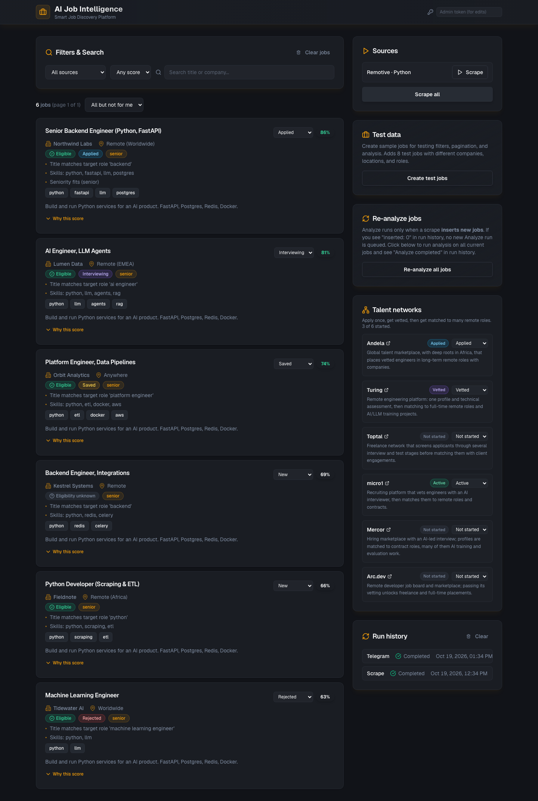

# FirstFetch — AI Job Intelligence

[](https://github.com/huss-huss/ai-job-intelligence-system/actions/workflows/ci.yml)

**Live demo:** [firstfetch-eight.vercel.app](https://firstfetch-eight.vercel.app) (read-only; refreshed daily by Vercel Cron) · API: [firstfetch-api.vercel.app/api/docs](https://firstfetch-api.vercel.app/api/docs)

FirstFetch pulls listings from public job APIs, scores each one against **your** profile with an explainable 0–100 score, and sends the strong matches to Notion.

I built it because job boards rank by recency, not fit, and most "remote" listings quietly require living in the US. FirstFetch reads the location and work-authorization rules first, so jobs you can't apply for never reach the top of the list.

```text
$ python -m worker.cli discover --top 3
Score  Elig  Title                                             Company                 Source
----------------------------------------------------------------------------------------------------
   52  ?     Senior .NET Software Engineer                     OkWhen                  remoteok
             Title matches target role 'software engineer' · Skills: typescript, aws · Seniority fits (senior) · ...
   51  ?     Senior Backend Engineer Build AI Agents           Salesforge              remoteok
             Title matches target role 'backend' · Skills: agents · Seniority fits (senior) · Location not specified
   47  ?     Senior React Full stack Developer                 Lemon.io                remoteok
             Target role mentioned in description, not title · Skills: python, llm, agents, node, typescript ...
----------------------------------------------------------------------------------------------------
117 fetched · 115 unique · 57 not open to your location · 0 LLM calls (0 tokens)
```
<sub>Real output from 2026-10-16 using the rules-only extractor (no API key).</sub>

## How it works

```text
 sources ──► fetch ──► dedupe ──► rules extract ──► pre-score ──► LLM extract* ──► score ──► Postgres / Notion / webhook
 (6 APIs +   (retry,   (per source   (skills,          (cheap)       (*only jobs      (0-100 with
  Playwright) throttle) + across      seniority,                       that pre-score   reasons)
                        boards)       salary, risks)                   ≥ 35)
```

- **Sources** (`worker/sources/`): Remotive, RemoteOK, Arbeitnow, Himalayas, any Greenhouse or Lever careers board, plus an opt-in Playwright scraper for sites without an API. All requests go through one HTTP client with throttling, exponential backoff with jitter, and `Retry-After` support.
- **Full descriptions** (`worker/sources/fulltext.py`): RemoteOK and Himalayas sometimes return only an excerpt, which under-counts skills. When a new posting from those sources has a description shorter than `FULL_DESCRIPTION_MIN_CHARS` (1500), FirstFetch fetches the posting page and uses the JSON-LD `JobPosting.description` if the page has one, or else the block holding most of the page's text, with navigation, sidebars, footers and link lists left out. Page fetches use the same throttled client, identify as `FirstFetch/…`, check `robots.txt` (cached per host, `Crawl-delay` honored) and stop trying a host after two failures in a row. The API text is kept whenever a fetch fails or the page has less text. Each scrape run has a budget, `FULL_DESCRIPTION_MAX_PAGES` (10) and `FULL_DESCRIPTION_MAX_SECONDS` (20), so the daily serverless run stays well inside its time limit. Each run's stats show `full_descriptions: {candidates, fetched, failed, skipped, ...}`. Set `FULL_DESCRIPTION_MIN_CHARS=0` to turn it off, `FULL_DESCRIPTION_SOURCES` to change which sources are fetched, or `"full_descriptions": true/false` in a source's config to override one source. Use `discover --no-full-descriptions` to skip it from the CLI.
- **Extraction** (`worker/ai.py`): keyword rules by default. With `OPENAI_API_KEY`, or `LLM_BASE_URL` pointing at any OpenAI-compatible server such as Ollama, a strict JSON schema is sent and the reply is validated with Pydantic. Any failure falls back to rules instead of failing the run. Token usage is recorded per job.
- **Scoring** (`worker/matching.py`): deterministic, so it's testable and auditable. The LLM supplies facts; it doesn't decide the score.

  | Component | Points | Notes |
  |---|---|---|
  | Role | 25 | target title in the job title (5 if only in the description) |
  | Skills | 35 | weighted coverage of your top skills; halved for off-target titles |
  | Location | 15 | "USA only", work-authorization clauses, and on-site roles make a job **ineligible** (score capped at 20) |
  | Seniority | 10 | |
  | Salary | 10 | top of the range, normalized to annual USD, against `min_salary_usd` (5 when unknown) |
  | Recency | 5 | days since the posting went live, or since its last update when the source reports one (see below) |
  | Risk flags | −10 each | commission-only, unpaid, upfront fees, vague postings |

- **Recency dates**: `posted_at` is always when the posting first went live. Greenhouse also returns `updated_at`, which keeps moving while a role stays open, so a requisition first published months ago isn't scored as stale: recency uses the newer of the two, and the reason says which (`Updated 3 days ago, first posted 251 days ago` vs `Posted 60 days ago`). An update less than a day after publishing counts as the original post. `updated_at` is kept in `jobs_raw.meta` (no column) and refreshed on every scrape, so `POST /api/analyze` rescores stored rows. Lever's public API only has `createdAt`, so Lever recency is the creation date; the other boards report a single publication date.

- **Salary normalization** (`worker/salary.py`): hourly × 2080 (40 h × 52 weeks), daily × 260, weekly × 52, monthly × 12; no period means annual and no currency means USD. Other currencies convert with a dated static table (USD per unit), which `FX_RATES_JSON='{"EUR": 1.1}'` overrides or extends. A currency or period the table doesn't know is scored as unknown, never guessed. Period and currency are read from the source's fields or from text such as `$40/hr`, `€5,000 per month`, `£70k`, `USD 120,000 - 150,000`. The reason shows both figures, e.g. `Salary up to €60,000/yr ≈ $70,200`. Stored `salary_min`/`salary_max` stay in the source's own unit.

- **Dashboard** (`frontend/`): each job card shows the top reasons and an eligibility badge (Eligible / Not open to your location / Eligibility unknown). "Why this score" expands the per-component points as bars, the risk penalty, the ineligible cap and the matched skills, all read from the stored `extracted_json.match`. Jobs not open to your location are hidden by default; the "Show N jobs not open to your location" toggle brings them back.

- **Notion** (`worker/notion.py`): upserts keyed by job URL, so re-runs update scores without duplicating pages. The `Status` you set in Notion is never overwritten.

- **Telegram and tracker** (`backend/app/telegram/`, `backend/app/tracker.py`): a daily digest of the best new matches with Applied / Save / Not for me buttons, an owner-only bot, and a per-job application tracker whose 👎/⭐/✅ history nudges similar jobs down or up. See [Telegram alerts](#telegram-alerts).

**Stack:** Python 3.12, FastAPI, SQLAlchemy + Alembic, PostgreSQL (pgvector), Redis + RQ, httpx, Pydantic, Next.js dashboard, Docker Compose, GitHub Actions.

## Quick start (no database)

```bash
python3 -m venv .venv && source .venv/bin/activate
pip install -r backend/requirements.txt -r worker/requirements.txt
cp profile.example.yaml profile.yaml        # edit titles, skills, location, salary floor
python -m worker.cli discover --top 15
python -m worker.cli discover --sources sources.example.yaml --json results.json
```

### Notion

1. Create an internal integration at https://www.notion.so/my-integrations and share a database with it.
2. Set `NOTION_TOKEN` and `NOTION_DATABASE_ID` in `.env`.
3. `python -m worker.cli notion-setup` adds the properties FirstFetch writes.
4. `python -m worker.cli discover --notion` syncs eligible jobs at or above `notify_threshold`.

### Telegram alerts

A Telegram bot sends you the day's best new matches and lets you track them from the chat. It talks
to the Bot API directly over httpx (`backend/app/telegram/`) and only ever answers your own chat.

**Daily digest.** At the end of the daily cron run (`GET /api/cron/discover`, so no extra cron is
needed) FirstFetch sends up to `TELEGRAM_DIGEST_SIZE` (5) jobs that were stored in the last
`TELEGRAM_DIGEST_MAX_AGE_DAYS` (7) days, are eligible or of unknown eligibility, nobody acted on yet, were
never sent before, and score at least `TELEGRAM_DIGEST_MIN_SCORE` (60, after the feedback adjustment
below). The score is the analysis `rank` when the scorer provides one, else the match score. Each job is
one message: title, company, location, score (and hire probability when present), the top two reasons and
an apply link, with buttons **✅ Applied · ⭐ Save · 👎 Not for me · 🔗 Open**. Tapping a button updates the
tracker and redraws the message with the new status (↩️ Undo resets it). A job is marked as sent only after
Telegram accepted it, so nothing is sent twice and a failed send is retried the next day. With nothing new
the bot sends one line, "No new strong matches today"; set `TELEGRAM_DIGEST_SEND_EMPTY=false` to skip it.
Telegram errors never fail the cron run: they're logged and recorded in a `telegram` row in run history.
In Redis mode, jobs analyzed after the cron request finishes go out in the next day's digest.

**Commands:** `/top` (best 5 open matches you haven't acted on), `/today` (stored since yesterday),
`/applied` (tracked jobs with status and notes), `/stats` (pipeline counts), `/pause` and `/resume` (the
digest), `/status <job id> <status>` (e.g. `/status 42 interviewing`), `/help`.

The client keeps under Telegram's limits: requests are spaced to stay under 30 messages a second, a 429 is
retried after the `retry_after` Telegram asks for (up to 30 s, three times), messages are HTML with every
field escaped, and lists longer than 4096 characters are split between whole lines.

**Setup** (about five minutes):

1. In Telegram, open [@BotFather](https://t.me/BotFather), send `/newbot`, pick a name and a username
   ending in `bot`. BotFather replies with the bot token.
2. Make a webhook secret: `python3 -c "import secrets; print(secrets.token_urlsafe(32))"`.
3. Add the token and the secret to the API project, in the Terminal app, from the repo root (each command
   prompts for the value, so it never lands in your shell history):
   ```bash
   vercel env add TELEGRAM_BOT_TOKEN production
   vercel env add TELEGRAM_WEBHOOK_SECRET production
   vercel deploy --prod
   ```
4. Point the bot at the API. Run this locally with the same two values (`read -s` keeps them out of the
   history too):
   ```bash
   read -rs TELEGRAM_BOT_TOKEN && export TELEGRAM_BOT_TOKEN
   read -rs TELEGRAM_WEBHOOK_SECRET && export TELEGRAM_WEBHOOK_SECRET
   python -m worker.cli telegram-setup --url https://<your-api-project>.vercel.app
   ```
   It calls `setWebhook` with the secret and `drop_pending_updates`, and registers the command menu.
5. Send `/start` to your bot. It replies with your chat id, and that's all it does until the id is set.
6. Add the chat id and redeploy:
   ```bash
   vercel env add TELEGRAM_CHAT_ID production
   vercel deploy --prod
   ```
7. Check it: `TELEGRAM_CHAT_ID=<id> python -m worker.cli telegram-test` sends a test message, and
   `DATABASE_URL=... python -m worker.cli telegram-digest --dry-run` prints what the digest would send now.

The webhook (`POST /api/telegram/webhook`) only accepts requests carrying the secret in Telegram's
`X-Telegram-Bot-Api-Secret-Token` header (compared in constant time). That header is also the only way
past the `ADMIN_TOKEN` write lock, and only for this one path. Updates from any other chat are ignored.

| Variable | Default | |
|---|---|---|
| `TELEGRAM_BOT_TOKEN` | | from BotFather; without it the bot and the digest are off |
| `TELEGRAM_WEBHOOK_SECRET` | | 1-256 characters of `A-Z a-z 0-9 _ -` |
| `TELEGRAM_CHAT_ID` | | your chat id, from `/start` |
| `TELEGRAM_DIGEST_SIZE` | 5 | jobs per digest |
| `TELEGRAM_DIGEST_MIN_SCORE` | 60 | 0-100, after feedback |
| `TELEGRAM_DIGEST_MAX_AGE_DAYS` | 7 | only jobs stored within this many days |
| `TELEGRAM_DIGEST_SEND_EMPTY` | true | send "no new strong matches" |
| `TELEGRAM_TIMEZONE` | Africa/Addis_Ababa | times shown in messages |

### Application tracker

Every job can have a status: `new`, `saved`, `applied`, `interviewing`, `offer`, `rejected` or
`not_interested`, plus notes and timestamps (status changed, first applied, sent to Telegram). It's stored in
the `applications` table (migration `003_tracker`), separate from the scraped data, so re-scraping or
re-analyzing never touches it. Set it from the Telegram buttons, `/status`, the select on each dashboard
card, or the API (`GET /api/applications?status=saved,applied`, `PATCH /api/applications/{job_id}` with
`{"status": "applied", "notes": "..."}`). The dashboard hides jobs marked "not for me" by default; the
status filter brings them back. On the public deployment, writes need the admin token (header field on the
dashboard, kept in your browser's localStorage).

**Feedback learning** (`backend/app/tracker.py`) is a small, fixed rule, not a model. When ranking the
digest and `/top`, each job is compared with the jobs you reacted to. Two jobs are *similar* when they
share at least 2 keywords and their keyword sets overlap by at least half (Jaccard ≥ 0.5); keywords are the
matched skills plus the title's role words, without seniority and filler words such as "senior" or
"engineer".

| Your history | Effect on the job |
|---|---|
| a similar job marked 👎 | −10 each |
| a 👎 job at the same company | −10 |
| a similar job saved or applied to | +5 each |
| a saved or applied job at the same company | +5 |
| total | clamped to −20 … +10 |

Each adjustment shows its reason in the message ("Similar to jobs you saved or applied to (fastapi,
python)") and the score shows both numbers ("Score 63 (58 + 5 feedback)"). The stored score never changes.

### Talent networks

The dashboard's **Talent networks** card lists platforms where one application and one vetting process
can lead to many remote roles: Andela, Turing, Toptal, micro1, Mercor and Arc.dev, each with a one-line
description and a link. Your status per platform (not started / applied / vetted / active) is stored in the
`talent_networks` table; `GET /api/talent-networks`, `PATCH /api/talent-networks/{slug}` with
`{"status": "vetted"}` (admin token on the public deployment). The descriptions say what each platform is,
not how likely you are to get in.



### Repairing stored text

Sources sometimes ship UTF-8 that was decoded as Latin-1/cp1252 (`We’re`). Adapters repair it on
ingest, but rows stored earlier keep the garbled text because re-analysis never rewrites `jobs_raw`.
`repair-text` fixes `title`, `company`, and `description` in place; it is idempotent.

```bash
DATABASE_URL=postgresql://... python -m worker.cli repair-text --dry-run   # show what would change
DATABASE_URL=postgresql://... python -m worker.cli repair-text             # apply
```

## Tests

```bash
pip install pytest ruff
pytest          # 322 tests, offline: adapters run against trimmed real API responses and saved HTML pages; Telegram against a fake Bot API (httpx.MockTransport); migrations on SQLite
TEST_DATABASE_URL=postgresql://postgres@localhost:5433/scratch pytest   # +2: eligibility filter (drops and recreates the job tables) and the migrations, in a throwaway schema, on a real Postgres
ruff check worker tests
```

---

## Local development (no Docker)

### 1. Environment

```bash
cp infra/.env.example .env
# Optional: OPENAI_API_KEY (or LLM_BASE_URL for a local model), NOTION_TOKEN, NOTION_DATABASE_ID
```

### 2. Virtual environment (recommended)

Using a **Python virtual environment** keeps backend and worker dependencies isolated and reproducible. Alternatives (e.g. global `pip`, Conda) work too, but a venv is the standard for local Python projects.

```bash
# From repo root
python3 -m venv .venv
source .venv/bin/activate   # On Windows: .venv\Scripts\activate
pip install --upgrade pip
pip install -r backend/requirements.txt -r worker/requirements.txt
```

Use this same activated venv for running the backend, worker, and Alembic. When you’re done, `deactivate` to leave the venv.

### 3. PostgreSQL + Redis

Start Postgres (with pgvector) and Redis locally, or use Docker for just the data layer:

```bash
docker compose -f infra/docker-compose.yml up -d postgres redis
```

Then run migrations (with your venv activated if you use one):

```bash
cd backend
alembic upgrade head
```

### 4. Backend

```bash
cd backend
uvicorn main:app --reload --host 0.0.0.0 --port 8000
```

API: http://localhost:8000 — Docs: http://localhost:8000/api/docs

### 5. Worker

From repo root (venv activated). RQ needs repo root on path so `worker.tasks` resolves:

```bash
# On macOS, set this if the worker crashes when running scrape (Playwright + fork):
export OBJC_DISABLE_INITIALIZE_FORK_SAFETY=YES
PYTHONPATH=backend:. rq worker default --path .
```

**Important:** If you see "Python stopped working unexpectedly" or scraping hangs:
- Make sure `OBJC_DISABLE_INITIALIZE_FORK_SAFETY=YES` is set before starting the worker
- Check worker logs for error messages (they'll appear in the terminal where you started the worker)
- Verify Redis is running: `redis-cli ping` should return `PONG`
- Check Run history in the UI - failed runs will show error details

### 6. Frontend

```bash
cd frontend
npm install
npm run dev
```

Dashboard: http://localhost:3000 — Uses Next.js rewrites to proxy `/api/*` to the backend (port 8000).

---

## Run full stack with Docker

```bash
cp infra/.env.example .env
docker compose -f infra/docker-compose.yml up -d --build
```

- API: http://localhost:8000  
- Frontend: run locally (`cd frontend && npm run dev`) and set `NEXT_PUBLIC_API_URL=http://localhost:8000` if needed (rewrites point to localhost:8000 by default).

---

## API overview

| Method | Endpoint | Description |
|--------|----------|-------------|
| GET | /api/health | Health check |
| GET | /api/sources | List sources |
| POST | /api/sources | Create source |
| POST | /api/sources/{id}/scrape | Enqueue scrape for one source |
| POST | /api/scrape | Enqueue scrape (all or body `source_id`) |
| GET | /api/jobs | List jobs (filter: source, min_score, q, eligible, status, page; sort: score or recent) |
| GET | /api/jobs/{id} | Job detail |
| GET | /api/runs | List scrape/analyze/telegram runs |
| GET | /api/applications | Tracked jobs (filter: status) |
| PATCH | /api/applications/{job_id} | Set status and/or notes |
| GET | /api/talent-networks | Talent networks with your status |
| PATCH | /api/talent-networks/{slug} | Set your status for one network |
| POST | /api/telegram/webhook | Telegram updates (secret header required) |

`eligible` filters on the stored location eligibility: `any` (default), or a comma-separated subset of `true`, `false`, `unknown`. Jobs whose posting doesn't say who can apply, or that aren't analyzed yet, count as `unknown`. The dashboard requests `eligible=true,unknown` and reads the size of the hidden set from `eligible=false&page_size=1`.

---

## Adding a job source

`config.type` picks the adapter; the other keys are adapter options (see `sources.example.yaml`).

```bash
curl -X POST http://localhost:8000/api/sources \
  -H "Content-Type: application/json" \
  -d '{"name": "Remotive · Python", "base_url": "https://remotive.com", "config": {"type": "remotive", "search": "python"}}'
```

Sources created before adapters existed (no `config.type`) keep working through the Playwright `html` adapter.

Then trigger a scrape from the dashboard or:

```bash
curl -X POST http://localhost:8000/api/scrape -H "Content-Type: application/json" -d '{}'
```

---

## Deploying to Vercel

Two Vercel projects plus a Neon Postgres database (free tiers are enough):

| Project | Root | What runs |
|---|---|---|
| API | repo root | `api/index.py` serves the FastAPI app as a Python function; `vercel.json` schedules `GET /api/cron/discover` daily |
| Dashboard | `frontend/` | static Next.js export; `frontend/vercel.json` proxies `/api/*` to the API project |

```bash
vercel link --project firstfetch-api            # from the repo root
vercel integration add neon                     # provisions Postgres and sets DATABASE_URL
DATABASE_URL=<unpooled url> alembic -c backend/alembic.ini upgrade head
vercel env add QUEUE_MODE production            # inline: no Redis/RQ worker on serverless
vercel env add CRON_SECRET production           # Vercel Cron sends it as a Bearer token
vercel env add ADMIN_TOKEN production           # makes the public deployment read-only
vercel deploy --prod
cd frontend && vercel link --project firstfetch && vercel deploy --prod
```

Writes against a deployment with `ADMIN_TOKEN` need the header `X-Admin-Token: <token>`. For Telegram
alerts add `TELEGRAM_BOT_TOKEN`, `TELEGRAM_WEBHOOK_SECRET` and `TELEGRAM_CHAT_ID` (see
[Telegram alerts](#telegram-alerts)), and run `alembic upgrade head` once for the tracker tables.

## Limitations and next steps

- Full descriptions depend on the job board serving the posting page to a non-browser client. As of October 2026, RemoteOK answers with a redirect loop and Himalayas with a Cloudflare challenge (HTTP 403), so on those boards the excerpt is usually kept (`failed` and `skipped_host` in the run stats). FirstFetch doesn't try to get around bot protection. Most RemoteOK and Himalayas API descriptions are already complete; only the short ones are fetched.
- Pages are only fetched for postings that aren't stored yet, so rows saved before this feature keep their excerpts.
- Salary conversion uses fixed assumptions: hourly rates are treated as full-time (2080 h/yr, no unpaid leave), 13th-month pay is ignored, and exchange rates come from a static table dated in `worker/salary.py` (override with `FX_RATES_JSON`). A bare `$` is read as USD, so CAD/AUD listings that write only `$` are slightly over-valued.
- Salary text without a period marker is taken as annual, so an unlabeled monthly figure ("€5,000") under-scores; currencies outside the table count as unknown.
- On Vercel each discovery runs inside one function call (up to 300 s) and the Hobby plan allows one cron run per day. Full-description fetching adds at most `FULL_DESCRIPTION_MAX_SECONDS` per source that uses it, plus a few seconds for the last request (40-50 s a day with the defaults). Docker Compose with the RQ worker has neither limit.
- The pgvector `embeddings` table exists but isn't used yet. Semantic similarity against a CV is planned as an extra scoring component.
- Respect each API's terms: Remotive asks for a few requests per day, and RemoteOK and Arbeitnow ask for links back to listings.

## Docs

- [docs/ai_job_intelligence_SRS.md](docs/ai_job_intelligence_SRS.md): requirements
- [docs/ai_job_intelligence_architecture_blueprint.md](docs/ai_job_intelligence_architecture_blueprint.md): architecture and data flow
- [docs/TESTING_AND_VERIFICATION.md](docs/TESTING_AND_VERIFICATION.md): testing
